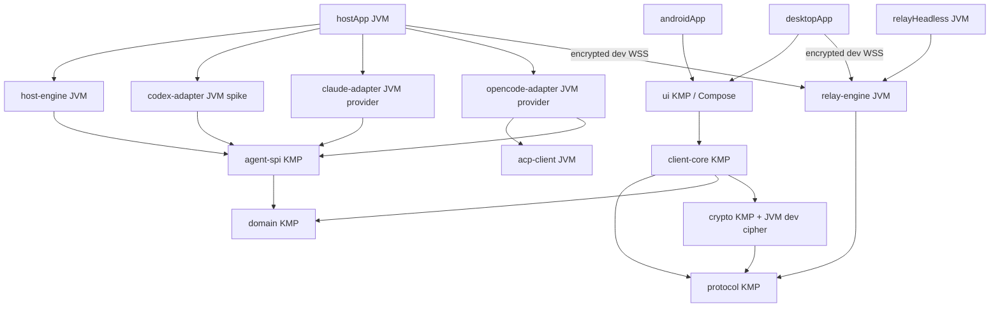

# Architecture — M0 + local vertical slice / 2026-10-18

The PRD is retained verbatim in Universal_Agent_Bridge_PRD.md.
Sections 16–17 refine deployment and process boundaries; section 15 limits the
first implementation to M0. The repository also contains an isolated local M1
vertical slice; production enrollment remains closed.

## Module graph

Shared modules compile for Android and JVM. Host/Relay compile only for JVM.
Android uses the AGP KMP library plugin in shared modules and a separate
application entry point. Desktop uses a JVM Compose application.

## Process boundaries

Host owns CLI child processes, project permissions and approvals. A production
Host must run as the interactive user. Relay routes encrypted envelopes and must
never become a remote shell. Normal mode exposes discovery/health only. Explicit
loopback dev mode routes authenticated opaque envelopes. The two command
line applications are independent of Desktop. Desktop's --relay-headless mode
runs the same RelayEngine without constructing a window. No GUI toggle/service
supervisor is implemented yet.

The Codex spike creates and terminates only its own fresh app-server child.
It does not attach to this development conversation or import external history.

## Harness discovery and app boundary

The mobile/Desktop application speaks one Agent Bridge domain protocol. It does
not know how Codex, Claude Code or OpenCode are launched. Host owns a
`HarnessRegistry` populated with built-in providers. On startup the registry
searches `PATH` plus standard per-user install roots, runs bounded fixed-argument
feature probes concurrently, and returns normalized `AgentInstallation` values.

Current built-ins select JSON-RPC stdio for Codex, JSON-lines stdio for Claude
Code and standard ACP stdio for OpenCode. The shared ACP client negotiates v1/v2,
routes correlated responses and exposes raw agent events/requests plus baseline
session operations. This removes per-harness configuration
from normal onboarding. Explicit executable overrides can be added later as a
diagnostic escape hatch, not as the primary flow. A probe proves interface
availability only; it does not expose a session in UI until the provider's
`AgentAdapter` lifecycle and contract tests are complete. All three built-ins
now implement this lifecycle; real model turns remain runtime validation work.

HarnessProvider also owns adapter construction. After discovery, Host asks the
registry for an app-facing AgentAdapter by agentId; executable paths and launch
arguments stay inside Host. `ManagedAgentHost` maps the same encrypted
`BridgePayload` commands to every adapter and automatically prefers Codex,
Claude, then OpenCode when the client does not select one.

## Current data boundaries

RelayInfo is available in every mode. In explicit local dev mode, EventEnvelope
carries AES-GCM encrypted `BridgePayload` between Desktop and Host; the Relay
only routes metadata. ApprovalGate is a
synchronized in-process policy primitive, not an authorization service.
DraftOutbox/SequenceCursor require serialized calls and are in-memory.
No production secrets or test keys are shipped; dev token/key come from env.

## Dependency baseline

| Component | Pinned |
|---|---|
| Kotlin/KMP/compiler | 2.4.20 |
| Compose Multiplatform | 1.12.1 |
| AGP | 9.1.1 |
| Gradle | 9.5.1 |
| Ktor | 3.6.0 |
| Coroutines / serialization | 1.11.0 / 1.11.0 |
| Activity Compose | 1.13.0 |
| JDK | 17 |
| Android min / compile / target | 30 / 37 / 36 |
| Locally inspected Codex | 0.163.0 |

Versions are fixed in gradle/libs.versions.toml and the wrapper. They are a
compatible baseline, not a claim to use the newest release of every component.
Android release target must be rechecked before Play publication.

Official references checked on 2026-10-18:
[Kotlin compatibility](https://kotlinlang.org/docs/gradle-configure-project.html),
[Compose compatibility](https://kotlinlang.org/docs/multiplatform/compose-compatibility-and-versioning.html),
[AGP 9.1](https://developer.android.com/build/releases/agp-9-1-0-release-notes),
[Ktor releases](https://ktor.io/docs/releases.html).
[Agent Client Protocol](https://agentclientprotocol.com/),
[OpenCode ACP](https://docs.opencode.ai/docs/acp/).
See validation.md for measured build results.
